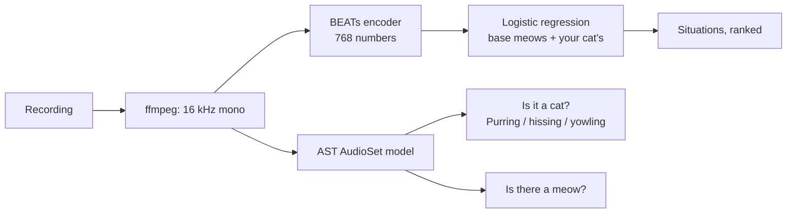

# Meow Decoder

[](https://github.com/ATHARV-IIT-BOMBAY/meow-decoder/actions/workflows/ci.yml)
[](https://colab.research.google.com/github/ATHARV-IIT-BOMBAY/meow-decoder/blob/main/notebooks/try_meow_decoder.ipynb)
[](https://huggingface.co/AtharvIITB/meow-decoder)
[](LICENSE)


**Record a meow. Get the likeliest reasons behind it, with percentages you can trust. Teach it your own cat and it learns that cat's voice.**

Cats don't meow in sentences, so this doesn't translate. It tells you which situation a meow sounds like, recognises purring, hissing and yowling, and says how sure it is. When it says 90%, it's right about 9 times in 10.

Every number here is measured on cats the model has never heard, because that's the situation you're in with a new cat. Most cat translators skip this test, which is how they get to 90%.

**[Try it free in Colab](https://colab.research.google.com/github/ATHARV-IIT-BOMBAY/meow-decoder/blob/main/notebooks/try_meow_decoder.ipynb)**, no install needed.

<br clear="right">

## Contents

- [What it can tell you](#what-it-can-tell-you)
- [Try it without installing](#try-it-without-installing)
- [Install](#install)
- [The app](#the-app)
- [Teach it your cat](#teach-it-your-cat)
- [Command line](#command-line)
- [Python API](#python-api)
- [HTTP API](#http-api)
- [Settings and where your data lives](#settings-and-where-your-data-lives)
- [How good is it?](#how-good-is-it)
- [Encoders and commercial use](#encoders-and-commercial-use)
- [How it works](#how-it-works)
- [Help build the open cat dataset](#help-build-the-open-cat-dataset)
- [Develop, retrain and reproduce](#develop-retrain-and-reproduce)
- [Deploy it](#deploy-it)
- [Troubleshooting](#troubleshooting)
- [Limits](#limits)
- [Roadmap](#roadmap)
- [Data, models, licenses and credits](#data-models-licenses-and-credits)

## What it can tell you

| | What | How sure |
|---|---|---|
| **Learned for every cat** | 🍗 Food, please · 😽 Enjoying attention · 🙀 Stressed somewhere new | First guess right 66% of the time, right answer in the top two 89%, on cats it has never heard |
| **Recognised directly** | 😌 Purring · 😾 Hissing · 📢 Yowling | Purring: false alarm on 0.2% of ordinary meows, caught all 5 test purrs. Yowling: false alarm on 3%. Hissing: no false alarms, but no test clips to confirm detections |
| **Learned for your cat** | 👋 Saying hello · 🚪 Wants to go out · 🧶 Wants to play · 😾 Annoyed · anything you type | Depends on how many meows you teach it |

What each sound usually means is shown with it. Purring, for example, usually means relaxed and content, but cats also purr to calm themselves when stressed or hurt. For a clip with no meow in it, like a purr, it doesn't guess a situation at all.

**What it doesn't do yet: pain, mating calls, fighting, a mother calling kittens.** A public 10-emotion cat dataset exists, and a model trained on it scores 80% when one clip is held out. But each emotion's clips mostly come from one or two recordings. Holding out whole recordings drops it to **17%**, near chance, and it caught **0 of 5 pain clips**. It had learned to recognise recordings, not emotions. A pain detector that's wrong most of the time could keep a hurt cat from a vet, so these wait for real data. [`benchmark/sound_types.py`](benchmark/sound_types.py) reproduces this.

## Try it without installing

The [Colab notebook](https://colab.research.google.com/github/ATHARV-IIT-BOMBAY/meow-decoder/blob/main/notebooks/try_meow_decoder.ipynb) runs on Google's free computers. Run the cells top to bottom (about two minutes to install), then:

1. Play three meows and a purr from the research datasets.
2. Upload your own recording: a voice memo, a phone video, any audio file.
3. Record a 6-second meow straight from your browser.
4. Open the full app, with the reacting cat and teaching, in a new tab.

Anything you teach in Colab disappears when the notebook stops.

## Install

You need Python 3.11 or newer (tested on 3.12) and [ffmpeg](https://ffmpeg.org/download.html):

```bash
brew install ffmpeg            # macOS
sudo apt install ffmpeg        # Ubuntu / Debian
```

```bash
pip install "meow-decoder @ git+https://github.com/ATHARV-IIT-BOMBAY/meow-decoder"
```

The first run downloads about 1 GB of models from Hugging Face (AST, the bioacoustic BEATs encoder and the 5 MB classifier weights), then works offline. It runs fine on a laptop CPU (on Apple Silicon, AST also uses the GPU). A prediction takes about 0.2 seconds.

## The app

```bash
meow serve          # open http://localhost:8000
```

- **Tap the cat to listen.** It records for up to 8 seconds; tap again to stop early. The cat's ears perk up and its pupils widen with the sound level.
- **Read the answer.** The cat's face changes with it: an open mouth for food, a happy squint for attention or purring, flattened ears and wide pupils for stress or hissing. A speech bubble shows what the cat might be saying, with bars for all three situations. Purring, hissing or yowling get their own card explaining what they usually mean.
- **No cat nearby?** Play a sample: a hungry cat, a cat being brushed, a cat somewhere new, or a purring cat. Or upload any recording or video.
- **Add your cats** with a name and an optional photo (it can use your phone camera), then [teach it](#teach-it-your-cat).
- **Not a cat?** If a clip doesn't sound like a cat (a fan, traffic, a person), it says so instead of pretending.
- It works on phones and desktops, in light and dark mode, and can be added to your phone's home screen. **How it works** in the header explains the accuracy in plain words.

**On a phone:** browsers only allow the microphone over https. With the app running on your computer, run:

```bash
cloudflared tunnel --url http://localhost:8000
```

and open the https link it prints on your phone. Anyone with that link can use your app, so share it only with people you trust.

## Teach it your cat

Add your cat, record a meow, and tap what was really happening: one of the three main situations, a quick pick (saying hello, wants to go out, wants to play, annoyed) or anything you type. The decoder refits on the base meows plus your cat's, with each of your meows counting 20 times as much. Quick picks and typed reasons become new options for that cat only.

On cats it had never heard, teaching helped this much:

| Meows taught per situation | 0 | 1 | 2 | 3 | 4 |
|---|---|---|---|---|---|
| First guess right | 66% | 74% | 77% | 80% | 81% |

Its card shows progress toward three meows per situation, which is where most of the gain is. Taught meows belong to the encoder that heard them, so if you switch encoders, that cat starts fresh.

## Command line

| Command | What it does | Options |
|---|---|---|
| `meow predict FILE...` | Ranks situations for each file and lists purring, hissing or yowling | `--json` one JSON object per line · `--encoder beats\|ast` |
| `meow serve` | Runs the app | `--host` (default 127.0.0.1) · `--port` (8000) · `--encoder` · `--no-contrib` hides dataset sharing |
| `meow train` | Retrains the classifier on CatMeows | `--data` (default `data/dataset`) · `--encoder` · `--out` (default `weights/`) |
| `meow benchmark` | Scores on the fixed unseen-cat folds | `--data` · `--encoder` |
| `meow export-dataset OUT` | Bundles the meows you chose to share as a Hugging Face dataset | |

```
$ meow predict hungry.wav purring.mp3

hungry.wav
   62%  🍗 Food, please: "I'm hungry. Where's my food?"
   37%  🙀 Stressed somewhere new: "I don't know this place. Where are you?"
    0%  😽 Enjoying the attention: "That feels nice, keep going."

purring.mp3
  😌 Purring: Usually relaxed and content. Cats also purr to calm themselves when stressed or hurt, so check the rest of its body language.
  No meow in this clip, so no situation guess.
```

`meow predict` reads anything ffmpeg can: wav, mp3, m4a, ogg, webm, and the audio track of mp4 or mov videos (the first 30 seconds).

## Python API

```python
from meow_decoder import Decoder

decoder = Decoder()                      # Decoder("ast") for commercial use
r = decoder.predict("my-cat.m4a")        # a path, raw bytes, or a 16 kHz mono numpy array

r["results"]    # situations, most likely first:
                # [{'key': 'F', 'emoji': '🍗', 'title': 'Food, please', 'line': "I'm hungry...", 'p': 0.62}, ...]
r["signals"]    # purring / hissing / yowling if heard: [{'key': 'Purr', 'title': 'Purring', 'meaning': ..., 'p': 0.87}]
r["has_meow"]   # False when the clip has no meow (a purr, a hiss): ignore r["results"] then
r["is_cat"]     # False when it doesn't sound like a cat at all
r["sounds"]     # raw AudioSet scores for Cat, Meow, Purr, Caterwaul, Hiss
```

Teach it a cat in code:

```python
emb1, _ = decoder.embed("biscuit-at-the-door-1.m4a")
emb2, _ = decoder.embed("biscuit-at-the-door-2.m4a")
biscuit = decoder.head.personalized([(emb1, "out"), (emb2, "out")])   # (embedding, label) pairs
decoder.predict("biscuit-new.m4a", head=biscuit)["results"][0]["title"]
```

`decoder.embed(audio)` returns `(embedding, sounds)` and `decoder.rank(embedding, sounds, head)` turns them into a result, so you can embed once and rank against several cats. `CONTEXTS`, `PRESETS` and `SIGNALS` hold the labels, emoji and wording. `Head.fit(X, y)` trains a new classifier on your own embeddings, with `.save()` and `Head.load()` for plain `.npz` files.

## HTTP API

`meow serve` exposes the JSON API the app uses. Send an `X-Meow-Owner` header with any random string to keep one user's cats separate from another's; without it, everything belongs to `local`.

| Method and path | Body | Returns |
|---|---|---|
| `GET /api/config` | | `{encoder, encoder_info, contrib}` |
| `GET /api/cats` | | Your cats: `[{id, name, photo, counts}]` |
| `POST /api/cats` | form: `name`, optional `photo` (a `data:image/` URL) | The new cat |
| `DELETE /api/cats/{id}` | | `{ok: true}` |
| `POST /api/predict` | form: `audio` file (max 10 MB), optional `cat_id` | A `predict` result plus `clip` (a token for teaching) and `taught` (meows taught for that cat) |
| `POST /api/teach` | JSON: `{cat_id, clip, label, share}` | The updated cat. `share: true` adds the meow to your open-dataset folder |

```bash
curl -F audio=@meow.m4a http://localhost:8000/api/predict
```

## Settings and where your data lives

| Variable | Default | What it controls |
|---|---|---|
| `MEOW_HOME` | `~/.meow-decoder` | Where the app keeps your cats and shared meows |
| `MEOW_WEIGHTS` | `weights` | Folder checked for `beats.npz` / `ast.npz` before downloading from Hugging Face |

**Privacy:**
- **Your cats:** `MEOW_HOME/cats.json` holds names, photos and meow embeddings (768 numbers per meow, which can't be played back). Your recordings are never stored.
- **Shared meows:** only meows you explicitly share are saved as audio, in `MEOW_HOME/contrib/`, with the label and an anonymous cat ID, never the name or photo.
- **Separate users:** each browser gets its own random ID, so on a shared server people only see their own cats.
- **Nothing is uploaded anywhere** unless you upload an export yourself.

## How good is it?

### The benchmark

440 meows from 21 cats ([CatMeows](https://zenodo.org/records/4008297)), split into 5 fixed folds of whole cats ([`meow_decoder/splits.json`](meow_decoder/splits.json)). Every test meow comes from a cat the model never trained on. `meow benchmark` reproduces these numbers exactly.

| Model | First guess | Top two | Log-loss | Calibration error |
|---|---|---|---|---|
| **Meow Decoder, bioacoustic BEATs** (default) | **65.9%** | **89.1%** | **0.757** | **2.2%** |
| Meow Decoder, AST (commercial-safe) | 61.8% | 84.1% | 0.907 | 4.7% |
| [MeowSense](https://github.com/sbor3937/MeowSense), SVM on AST\* | 60% ± 10 | | | |
| Classic MFCC features + logistic regression | 57.5% | | | |
| Always guess "stressed" | 50.2% | | | |
| Same model, on cats it has already heard | 74.1% | | | |

\*MeowSense uses its own grouped folds, so that comparison is close but not exact. [Submit your model](.github/ISSUE_TEMPLATE/benchmark-result.md) to add it here.

### By situation

| Real situation | Meows | Caught | When it guesses this, it's right |
|---|---|---|---|
| 🙀 Stressed somewhere new | 221 | 84% | 80% |
| 😽 Enjoying attention | 127 | 60% | 59% |
| 🍗 Food, please | 92 | 30% | 35% |

Food and attention meows sound alike to it. Trust "stressed" the most and "food" the least.

### Can you trust the percentages?

Yes. Grouped by how sure it said it was:

| It said (average) | It was right | Meows |
|---|---|---|
| 45% | 45% | 71 |
| 55% | 48% | 92 |
| 65% | 64% | 77 |
| 75% | 73% | 75 |
| 89% | 88% | 125 |

When it's at least 80% sure, which happens for 28% of meows, it's right 88% of the time.

### Every cat is different

Accuracy on a single unseen cat ranges from 20% to 95%. Some cats meow the way the training cats did and some don't, which is why [teaching your cat](#teach-it-your-cat) helps so much.

### What we tried that didn't help

- **Temperature scaling** (the standard calibration fix) made the earlier AST model's percentages worse overall. Switching to the bioacoustic encoder is what fixed calibration.
- **Trimming silence** and **using other transformer layers** made no difference beyond noise.
- **A bigger language model** wouldn't help: the limit is labelled cat audio, not model size.

### Why published 90% figures don't compare

| Project | Reported | Tested on cats it hadn't heard? |
|---|---|---|
| **Meow Decoder** | **66% (3 situations)** | Yes |
| [MeowSense](https://github.com/sbor3937/MeowSense) | 60% (3 situations) | Yes |
| MeowSense, same model with a random split | 74% | No |
| Multi-QuadEmoNet (Frontiers in Veterinary Science, 2026) | 90% (6 emotions) | No: altered copies of each clip in both training and test |
| MeowTalk app (2021 claim) | 90% (9 intents) | Unknown; lab conditions. Reviewers estimate 65–75% in daily use |

Many cat-sound papers augment their clips (noise, pitch shift, filtering) and then split at random, so altered copies of the same recording land on both sides. On the 50 public clips of the Cat Sound Classification V2 dataset (10 emotions), the same model scores:

| Split | Accuracy |
|---|---|
| Augment, then split randomly | 99.8% |
| Keep every copy of a clip on one side | 84.4% |
| Keep every clip from the same recording on one side | 17%\* |
| Chance | 10% |

\*Only 7 of the 10 emotions could be tested this way: the other 3 come from a single recording each, so nothing is left to learn them from once it's held out.

### Reproduce everything

```bash
meow benchmark                     # headline numbers, both encoders with --encoder
python benchmark/evaluate.py       # full report -> benchmark/report.json: confusion matrix, calibration,
                                   # per-cat accuracy, teaching curve, MFCC baseline, augment-split re-test
python benchmark/sound_types.py    # why pain etc. aren't shipped, and sound-detector false alarms -> benchmark/sound_types.json
```

## Encoders and commercial use

| Encoder | First guess | Calibration error | License | Use it for |
|---|---|---|---|---|
| `beats` (default): [Earth Species Project BEATs](https://huggingface.co/EarthSpeciesProject/esp-aves2-sl-beats-all), trained on animal sounds | 65.9% | 2.2% | CC BY-NC-SA 4.0, **non-commercial** | Personal, research, education |
| `ast`: [MIT AST fine-tuned on AudioSet](https://huggingface.co/MIT/ast-finetuned-audioset-10-10-0.4593) | 61.8% | 4.7% | BSD-3-Clause | Anything, including commercial |

```bash
meow serve --encoder ast
meow predict --encoder ast my-cat.m4a
```

The meow code itself is MIT either way. Purring, hissing and yowling always come from AST.

## How it works



- **Two frozen audio models.** The bioacoustic BEATs encoder turns a clip into 768 numbers, and a small logistic regression ranks the situations. AST, trained on AudioSet's 527 everyday sounds, checks whether it's a cat, whether there's a meow, and whether it's purring, hissing or yowling.
- **A deliberately simple classifier.** With only 440 training meows, a strongly regularised logistic regression is hard to overfit and gives honest probabilities. Its weights are plain NumPy arrays on [Hugging Face](https://huggingface.co/AtharvIITB/meow-decoder), so loading them can't run code (no pickles).
- **Teaching** keeps the base embeddings alongside the weights and refits in under a second with your cat's meows added.
- **The app** is a FastAPI server ([`server.py`](meow_decoder/server.py)) and one HTML file ([`index.html`](meow_decoder/static/index.html)) with no build step. The cat is an inline SVG drawing whose face is driven by CSS.

## Help build the open cat dataset

Every open cat model, this one included, learned from the same 440 meows of 21 European pet cats. The fix is more meows from more cats:

1. In the app, tick **Also add this meow to the open cat dataset** before you tap what was happening.
2. Run `meow export-dataset my-meows` to bundle what you've shared, with a metadata file and a dataset card.
3. Upload it to Hugging Face (`huggingface-cli upload <you>/<name> my-meows --repo-type dataset`) or open an issue with a link, and we'll merge it into the shared dataset.

Shared meows are CC BY 4.0 and carry only the sound, the label and an anonymous cat ID. Street cats, other breeds and other countries help most. A new situation becomes available to everyone once shared meows come from at least 10 different cats and it passes the unseen-cat test ([CONTRIBUTING.md](CONTRIBUTING.md)).

## Develop, retrain and reproduce

```bash
git clone https://github.com/ATHARV-IIT-BOMBAY/meow-decoder && cd meow-decoder
pip install -e ".[dev]"
pytest                                   # 8 tests, about a second, no model downloads

# Data for training and the benchmark scripts
mkdir -p data && curl -L -o data/catmeows.zip "https://zenodo.org/records/4008297/files/dataset.zip?download=1" && unzip -q data/catmeows.zip -d data
mkdir -p data/catsound && curl -L -o data/catsound/s.zip "https://zenodo.org/api/records/4724180/files/CAT_SOUND_DB_SAMPLES.zip/content" && unzip -q data/catsound/s.zip -d data/catsound

meow train && meow benchmark             # writes weights/beats.npz, used instead of the downloaded weights
```

`requirements.txt` pins the exact library versions the published numbers came from. CI runs the tests on every push. Before changing anything that affects predictions, read [CONTRIBUTING.md](CONTRIBUTING.md): pull requests need `meow benchmark` numbers before and after.

```
meow_decoder/
  core.py            audio loading, encoders, classifier, Decoder, benchmark
  server.py          the web app's API
  cli.py             the meow command
  splits.json        fixed unseen-cat benchmark folds
  static/            the app: index.html, icon, manifest, demo samples
benchmark/
  evaluate.py        full held-out report  -> report.json
  sound_types.py     extra sound types and detector false alarms  -> sound_types.json
notebooks/           the Colab "Try it" notebook
tests/               model-free tests
hf/model/            the Hugging Face model card
hf/space/            Dockerfile and card for a Hugging Face Space
docs/                demo GIF, launch post drafts
```

## Deploy it

- **Your own machine, shared with a few people:** `meow serve --host 0.0.0.0` on your network, or `cloudflared tunnel` for an https link.
- **Any server with Docker:** [`hf/space/Dockerfile`](hf/space/Dockerfile) builds a CPU image that downloads the models at build time and serves on port 7860. Plan for 2–3 GB of RAM.
- **Hugging Face Spaces:** the same folder works as a Docker Space, which now needs a Hugging Face PRO plan. Upload `hf/space/` as a Space.

Use `--encoder ast` for a commercial deployment, and `--no-contrib` if you won't collect shared meows.

## Troubleshooting

| Problem | Fix |
|---|---|
| `Couldn't read that audio` | Install ffmpeg (see [Install](#install)), or the file isn't audio |
| "Microphone isn't available here" | Browsers only allow the mic on https or localhost. Use `cloudflared tunnel`, or upload a recording |
| "Microphone is blocked" | Allow the microphone for the site in your browser's settings |
| "Doesn't sound much like a cat" | Record closer to the cat, away from fans, TV and traffic |
| First run is slow | It's downloading about 1 GB of models, once |
| A taught cat forgot everything | Taught meows belong to one encoder; switching `--encoder` starts each cat fresh |
| The page looks out of date after upgrading | Reload it; the server tells browsers to re-check |

## Limits

- Three learned situations, plus purring, hissing and yowling. It can't detect pain or illness. **If a cat seems unwell, see a vet.**
- Trained on 21 Maine Coon and European Shorthair pet cats recorded by the University of Milan. Street cats and other breeds may sound different.
- The training audio is 8 kHz, so the models never heard anything above 4 kHz.
- It was trained on clean recordings of one cat at a time. With several cats or loud background noise, expect it to be less reliable.

## Roadmap

- **More situations for everyone**, starting with the quick picks, as shared meows from enough cats come in.
- **Pain, fighting, mating and mother calls**, once there's data with many independent recordings per class.
- **On-device inference** (ONNX in the browser), so audio never leaves your phone and the demo can run anywhere for free.
- **A PyPI release** for plain `pip install meow-decoder`.

Ideas and help are welcome: see [CONTRIBUTING.md](CONTRIBUTING.md). Changes are listed in [CHANGELOG.md](CHANGELOG.md).

## Data, models, licenses and credits

- **Code:** MIT ([LICENSE](LICENSE)).
- **[CatMeows](https://zenodo.org/records/4008297)** by Ludovico, Ntalampiras, Presti, Cannas, Battini and Mattiello (2020), CC BY 4.0: the training data. Three of its meows ship as demo samples.
- **[Cat Sound Classification Dataset V2](https://zenodo.org/records/4724180)** by Pandeya, Kim and Lee, CC BY 4.0: used for the re-tests. Its purring clip ships as a demo sample.
- **[esp-aves2-sl-beats-all](https://huggingface.co/EarthSpeciesProject/esp-aves2-sl-beats-all)** by Earth Species Project, CC BY-NC-SA 4.0.
- **[AST fine-tuned on AudioSet](https://huggingface.co/MIT/ast-finetuned-audioset-10-10-0.4593)** (Gong et al.), BSD-3-Clause.
- **Weights:** `beats.npz` follows the BEATs license; `ast.npz` follows CatMeows (CC BY 4.0).

If this helps your research, please cite it ([CITATION.cff](CITATION.cff)) along with CatMeows. Thanks to the MeowSense project for an honest benchmark to compare against.
