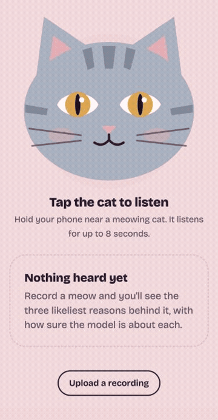
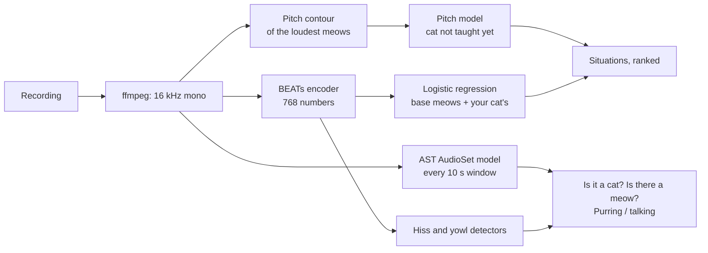

# Meow Decoder

[](https://github.com/ATHARV-IIT-BOMBAY/meow-decoder/actions/workflows/ci.yml)
[](https://colab.research.google.com/github/ATHARV-IIT-BOMBAY/meow-decoder/blob/main/notebooks/try_meow_decoder.ipynb)
[](https://huggingface.co/AtharvIITB/meow-decoder)
[](https://huggingface.co/datasets/AtharvIITB/open-cat-meows)
[](LICENSE)



**Record a meow. Get the likeliest reasons behind it, with percentages you can trust. Teach it your own cat and it learns that cat's voice.**

Cats don't meow in sentences, so this doesn't translate. It tells you which situation a meow sounds like, recognises purring, hissing and yowling, and says how sure it is. When it isn't sure, it says so.

Every number here is measured on cats the model has never heard, because that's the situation you're in with a new cat. Most cat translators skip this test, which is how they get to 90%.

**[Open the app in your browser](https://atharv-iit-bombay.github.io/meow-decoder/)**: nothing to install, and the audio never leaves your phone. Or [try it in Colab](https://colab.research.google.com/github/ATHARV-IIT-BOMBAY/meow-decoder/blob/main/notebooks/try_meow_decoder.ipynb).

<br clear="right">

## New in v0.5.0

- **Situation guesses that work on real recordings, a bit.** Tested on 179 openly licensed recordings people made at home ([below](#tested-on-real-recordings-from-the-internet)), the old guess was right 14% of the time: it had learned one lab's recording setup. For cats you haven't taught yet, it now guesses from the *shape of the meow's pitch*: rising meows tend to be about food, falling ones about stress, a pattern phoneticians found across many cats. On real recordings: **14% → 45%** first guess, 26% → 66% top two. Still a rough guess, and it says so.
- **Hissing and yowling detectors trained on real recordings** (FSD50K and Freesound). Real hisses caught **5 → 9 of 13**, fights and mating calls **12 → 22 of 24**, and the hiss detector no longer fires on fans and steam.
- Once you teach it your cat, it switches to learning from your own cat's meows, as before.

## Corrections in v0.4.0

An independent review of v0.3.1 tested our own claims harder than we had. What changed:

- **Teaching your cat helps less than we said.** We reported 66% → 81% after teaching 4 meows per situation. That test used meows from the same recording session as the taught ones, which share the room and microphone. Tested on a *different* session, as in real use: **65% → 72%** after 3 per situation. The same-session figure is 87%, which shows how much a shared session inflates it.
- **Every headline number now has an uncertainty range.** With 21 cats the benchmark is small: 65.9% is really "somewhere between 57% and 74%".
- **We measured what the app actually hears.** Through a browser microphone's codec it's 61.8%. With heavy background noise it's 59%.
- **Part of the signal may be the room.** A model that sees only the quietest fifth of each clip, with as little meow as possible, scores 61%. Cutting clips down to just the meow keeps 64%, so the meow carries signal too. This data can't fully separate the two.
- **On real recordings from the internet, the situation guess didn't work** (fixed in part in v0.5.0, above). In v0.4.2 we tested it on 58 meows from 45 uploaders on Wikimedia Commons and Freesound, each with a description saying what was happening. Its first guess was right 8 times (14%, worse than guessing at random), and it called 2 of 48 food-begging meows "food". The 66% below holds for CatMeows-style recordings, not for a phone in your kitchen. Purring and hissing detection does carry over. [Details](#tested-on-real-recordings-from-the-internet).

The full analysis is in [How good is it?](#how-good-is-it). The [changelog](CHANGELOG.md) lists every fix.

## Contents

- [What it can tell you](#what-it-can-tell-you)
- [Try it without installing](#try-it-without-installing)
- [Install](#install)
- [The app](#the-app)
- [Teach it your cat](#teach-it-your-cat)
- [Command line](#command-line)
- [Python API](#python-api)
- [HTTP API](#http-api)
- [Settings, privacy and limits](#settings-privacy-and-limits)
- [How good is it?](#how-good-is-it)
- [Encoders and commercial use](#encoders-and-commercial-use)
- [How it works](#how-it-works)
- [Help build the open cat dataset](#help-build-the-open-cat-dataset)
- [Develop, retrain and reproduce](#develop-retrain-and-reproduce)
- [Deploy it](#deploy-it)
- [Troubleshooting](#troubleshooting)
- [Limits](#limits)
- [Roadmap](#roadmap)
- [Data, models, licenses and credits](#data-models-licenses-and-credits)

## What it can tell you

| | What | How sure |
|---|---|---|
| **Guessed for every cat** | 🍗 Food, please · 😽 Enjoying attention · 🙀 Stressed somewhere new | Before you teach it: from the meow's pitch contour. On 55 real meows from the internet, first guess right 45%, top two 66%, so it usually says "it's between" two. It rarely picks out attention meows. After teaching: learned from your cat's own meows |
| **Recognised directly** | 😌 Purring · 😾 Hissing · 📢 Yowling | On real recordings from the internet: caught 26 of 30 purrs, 9 of 13 hisses and 22 of 24 fights and mating calls. Purring sometimes fires on cats purring while they beg; yowling also fires on loud, demanding meows |
| **Learned for your cat** | 👋 Saying hello · 🚪 Wants to go out · 🧶 Wants to play · 😾 Annoyed · anything you type | Depends on what you teach it. Shown as "learning" until you've taught it 3 times |

What each sound usually means is shown with it. Purring, for example, usually means relaxed and content, but cats also purr to calm themselves when stressed or hurt. For a clip with no meow in it, like a purr, or one that doesn't sound like a cat at all, it doesn't guess a situation. When its top answer is under 50%, it says "It's between food and attention" instead of picking one.

**What it doesn't do yet: pain, mating calls, fighting, a mother calling kittens.** A public 10-emotion cat dataset exists, and a model trained on it scores 80% when one clip is held out. But each emotion's clips mostly come from one or two recordings. Holding out whole recordings drops it to **17%**, near chance, and it caught **0 of 5 pain clips**. It had learned to recognise recordings, not emotions. A pain detector that's wrong most of the time could keep a hurt cat from a vet, so these wait for real data. [`benchmark/sound_types.py`](benchmark/sound_types.py) reproduces this.

## Try it without installing

**[atharv-iit-bombay.github.io/meow-decoder](https://atharv-iit-bombay.github.io/meow-decoder/)** runs the whole app in your browser, on GitHub Pages. There's no server: the AudioSet model ([Xenova's quantized copy](https://huggingface.co/Xenova/ast-finetuned-audioset-10-10-0.4593), about 90 MB, downloaded once) runs through [transformers.js](https://github.com/huggingface/transformers.js), the pitch model and teaching run in plain JavaScript ([`web/`](web/)), and your cats are saved in that browser only. Recordings never leave the device, so the share-to-dataset option is off there.

How it compares with the full app (`meow serve`):

| | Browser version | Full app |
|---|---|---|
| Situation guess before teaching | Pitch contour, same code: 45% on real meows | same |
| Purring / hissing / yowling caught on real recordings | 25 of 30 / 5 of 13 / 21 of 24 | 26 of 30 / 9 of 13 / 22 of 24 |
| Teaching, CatMeows across sessions | 59% → 65% after 3 per situation | 65% → 72% |
| Where it runs | your phone or laptop | a server you run |

[`tests/test_web.py`](tests/test_web.py) checks the JavaScript against the Python code (meow finding exactly, pitch within 0.001, teaching within 0.02), and [`benchmark/export_web.py`](benchmark/export_web.py) rebuilds `web/model.json`.

The [Colab notebook](https://colab.research.google.com/github/ATHARV-IIT-BOMBAY/meow-decoder/blob/main/notebooks/try_meow_decoder.ipynb) runs on Google's free computers. Run the cells top to bottom (about two minutes to install), then:

1. Play three meows and a purr from the research datasets.
2. Upload your own recording: a voice memo, a phone video, any audio file.
3. Record a 6-second meow straight from your browser.
4. Open the full app, with the reacting cat and teaching, in a new tab.

Anything you teach in Colab disappears when the notebook stops.

## Install

You need Python 3.11 or newer (tested on 3.11–3.13) and [ffmpeg](https://ffmpeg.org/download.html):

```bash
brew install ffmpeg            # macOS
sudo apt install ffmpeg        # Ubuntu / Debian
```

```bash
pip install "meow-decoder @ git+https://github.com/ATHARV-IIT-BOMBAY/meow-decoder@v0.6.0"
```

The first run downloads about 1 GB of models from Hugging Face (AST, the bioacoustic BEATs encoder and the 5 MB classifier weights), then works offline. Every download is pinned to an exact revision, so an install keeps getting the same models. It runs fine on a laptop CPU (on Apple Silicon, AST also uses the GPU). A prediction takes about 0.2 seconds.

## The app

```bash
meow serve          # open http://localhost:8000
```

- **Tap the cat to listen.** It records for up to 8 seconds; tap again to stop early. The cat's ears perk up and its pupils widen with the sound level.
- **Read the answer.** The cat's face changes with it: an open mouth for food, a happy squint for attention or purring, flattened ears and wide pupils for stress or hissing. A speech bubble shows what the cat might be saying, with bars for every option. Purring, hissing or yowling get their own card explaining what they usually mean.
- **See why it guessed.** Before you've taught it your cat, the answer comes from the meow's pitch, and the app draws the loudest meow's pitch line under the answer: "This meow rose 1.5 semitones. Rising meows lean food."
- **When it isn't sure,** it says "It's between attention and food" and asks which one it was. Those are the most useful meows to teach. Until a cat has about 3 taught meows of each kind, it says its percentages are still early guesses.
- **No cat nearby?** Play a sample: a hungry cat, a cat being brushed, a cat somewhere new, or a purring cat. Afterwards it shows what was really happening in that recording and whether its guess was right. Or upload any recording or video.
- **Add your cats** with a name and an optional photo (it can use your phone camera), then [teach it](#teach-it-your-cat). Switching cats re-ranks the last recording for the cat you picked.
- **Not a cat?** If a clip doesn't sound like a cat (a fan, traffic, a person talking), it says so instead of guessing.
- It works on phones and desktops, in light and dark mode, and can be installed to your phone's home screen. Once installed it opens even offline; predictions still need the server. **How it works** in the header explains the accuracy in plain words.

**On a phone:** browsers only allow the microphone over https. With the app running on your computer, run:

```bash
cloudflared tunnel --url http://localhost:8000
```

and open the https link it prints on your phone. The server then requires each browser's ID and rate-limits uploads, but there are no logins, so share the link only with people you trust.

## Teach it your cat

Until you teach it, its situation guess comes from the meow's pitch contour (see [real recordings](#tested-on-real-recordings-from-the-internet)). Once you do, it learns from your cat's own meows, recorded on your phone in your home.

Add your cat, record a meow, and tap what was really happening: one of the three main situations, a quick pick (saying hello, wants to go out, wants to play, annoyed) or anything you type. The decoder refits on the base meows plus your cat's, with each of your meows counting 20 times as much. Quick picks and typed reasons become new options for that cat only, shown as "learning" until taught 3 times.

Taught the wrong thing? Tap **Undo**, or remove any taught meow from the cat's card. Teaching the same recording twice changes its label instead of counting it twice.

Once a cat has 5 or more taught meows of one kind with their local time, its card points out patterns, like "Most food meows come around 7 pm (4 of 6)".

How much teaching helps, on cats the model had never heard. Taught meows all come from one recording session; the cat is then tested on its other sessions, like using the app on a different day:

| Meows taught per situation | 0 | 1 | 2 | 3 | 4 |
|---|---|---|---|---|---|
| First guess right, tested on another session | 64.9% | 67.7% | 71.3% | 72.1% | 71.5% |
| Average confidence it showed | 67% | 68% | 70% | 72% | 72% |
| *Tested on the same session (optimistic)* | *65.5%* | *77.9%* | *82.9%* | *87.1%* | *83.3%* |

Its percentages stay honest after teaching: confidence tracks accuracy. With the same meows played through a simulated room (reverb, distance, noise), the untaught pitch guess got 50% and one taught meow per situation 65%, which is why the app switches to your cat's meows as soon as you teach one. Most of the gain comes from the first 3 meows per situation. The weight of 20 was chosen on half the cats and held up on the other half.

## Command line

| Command | What it does | Options |
|---|---|---|
| `meow predict FILE...` | Ranks situations for each file and lists purring, hissing or yowling. Skips files it can't read and carries on | `--json` one JSON object per line · `--encoder beats\|ast` |
| `meow serve` | Runs the app | `--host` (default 127.0.0.1) · `--port` (8000) · `--encoder` · `--no-contrib` hides dataset sharing |
| `meow train` | Retrains the classifier on CatMeows (needs `[train]`) | `--data` (default `data/dataset`) · `--encoder` · `--out` (default `weights/`) |
| `meow benchmark` | Scores on the fixed unseen-cat folds | `--from-weights` uses the embeddings stored in the weights (seconds, no audio or models) · `--teaching` adds the cross-session teaching curve · `--robust` adds real-world recording conditions · `--predictions FILE.csv` scores your own model · `--data` · `--encoder` |
| `meow export-dataset OUT` | Bundles the meows you chose to share as a Hugging Face dataset | `--include-custom-labels` keeps your typed labels (check them for names first) |
| `meow contribute` | Sends your shared meows to the [open dataset](https://huggingface.co/datasets/AtharvIITB/open-cat-meows) as a pull request | Needs `huggingface-cli login` |

```
$ meow predict hungry.wav purring.mp3

hungry.wav
   62%  🍗 Food, please: "I'm hungry. Where's my food?"
   37%  🙀 Stressed somewhere new: "I don't know this place. Where are you?"
    0%  😽 Enjoying the attention: "That feels nice, keep going."

purring.mp3
  😌 Purring: Usually relaxed and content. Cats also purr to calm themselves when stressed or hurt, so check the rest of its body language.
  No meow in this clip, so no situation guess.
```

`meow predict` reads anything ffmpeg can: wav, mp3, m4a, ogg, webm, and the audio track of mp4 or mov videos (the first 30 seconds). Purring, hissing and yowling are listened for across the whole 30 seconds.

## Python API

```python
from meow_decoder import Decoder

decoder = Decoder()                      # Decoder("ast") for commercial use
r = decoder.predict("my-cat.m4a")        # a path, raw bytes, or a 16 kHz mono numpy array

r["results"]    # situations, most likely first:
                # [{'key': 'F', 'emoji': '🍗', 'title': 'Food, please', 'line': "I'm hungry...", 'p': 0.62}, ...]
r["signals"]    # purring / hissing / yowling if heard: [{'key': 'Purr', 'title': 'Purring', 'meaning': ..., 'p': 0.87}]
r["has_meow"]   # False when there's no meow to read (a purr, a hiss, or not a cat): ignore r["results"] then
r["is_cat"]     # False when it doesn't sound like a cat at all
r["sounds"]     # raw AudioSet scores for Cat, Meow, Purr, Caterwaul, Hiss and Speech
r["guess_from"] # "pitch" (no cat taught), "taught" (a head you passed), or "embedding" (rank() without pitch)
```

Teach it a cat in code:

```python
emb1, _ = decoder.embed("biscuit-at-the-door-1.m4a")
emb2, _ = decoder.embed("biscuit-at-the-door-2.m4a")
biscuit = decoder.head.personalized([(emb1, "out"), (emb2, "out")])   # (embedding, label) pairs
decoder.predict("biscuit-new.m4a", head=biscuit)["results"][0]["title"]
```

`decoder.embed(audio)` returns `(embedding, sounds)` and `decoder.rank(embedding, sounds, head, pitch)` turns them into a result (`pitch` from `pitch_features(wave)`; without a head it guesses from it), so you can embed once and rank against several cats. `CONTEXTS`, `PRESETS` and `SIGNALS` hold the labels, emoji and wording. `Head.fit(X, y)` trains a new classifier on your own embeddings, with `.save()` and `Head.load()` for plain `.npz` files. Evaluation lives in `meow_decoder.bench`: `benchmark`, `teaching_curve`, `robustness` and `metrics`.

## HTTP API

`meow serve` exposes the JSON API the app uses. Send an `X-Meow-Owner` header with any random string to keep one user's cats separate from another's. On `127.0.0.1` a missing header means the single local user; on any other address the server refuses requests without it.

| Method and path | Body | Returns |
|---|---|---|
| `GET /api/config` | | `{encoder, encoder_info, contrib}` |
| `GET /api/cats` | | Your cats: `[{id, name, photo, counts, samples}]`, with the 50 most recent taught meows |
| `POST /api/cats` | form: `name`, optional `photo` (a `data:image/` URL) | The new cat (up to 20 per owner) |
| `DELETE /api/cats/{id}` | | `{ok: true}` |
| `DELETE /api/cats/{id}/samples/{sample_id}` | | The cat, without that taught meow |
| `POST /api/predict` | form: `audio` file (max 10 MB), optional `cat_id` | A `predict` result plus `clip` (a token for teaching) and `taught` (meows taught for that cat). Rate-limited to 30 a minute per address |
| `POST /api/rerank` | JSON: `{clip, cat_id}` | The same recording ranked for another cat |
| `POST /api/teach` | JSON: `{cat_id, clip, label, share, session, hour, where}` | The updated cat plus `sample_id`; with `share`, also `shared` and `contribution_id`, or `share_note` saying why it wasn't shared. Up to 200 taught meows per cat |

```bash
curl -F audio=@meow.m4a http://localhost:8000/api/predict
```

## Settings, privacy and limits

| Variable | Default | What it controls |
|---|---|---|
| `MEOW_HOME` | `~/.meow-decoder` | Where the app keeps your cats and shared meows |
| `MEOW_WEIGHTS` | `weights` | Folder checked for `beats.npz` / `ast.npz` before downloading from Hugging Face |

**Privacy:**
- **Your cats:** `MEOW_HOME/cats.json` holds names, photos, taught labels with their local hour, and meow embeddings (768 numbers per meow, which can't be played back). Your recordings are never stored. Browser IDs are stored only as hashes. The file is saved atomically, so a crash can't corrupt it.
- **Shared meows:** only meows you explicitly share are saved as audio, in `MEOW_HOME/contrib/`. Each comes with its label, an anonymous cat ID, an anonymous visit ID, phone or computer, the local hour, optionally where it was recorded, and a contribution ID you can quote to have it removed. Never the cat's name or photo. Words you type as a label are kept out of exports unless you choose to include them. Clips with talking in them, or that don't sound like a cat, are refused.
- **Nothing is uploaded anywhere** unless you run `meow contribute` or upload an export yourself.

## How good is it?

### The benchmark

440 meows from 21 cats ([CatMeows](https://zenodo.org/records/4008297)), split into 5 fixed folds of whole cats ([`meow_decoder/splits.json`](meow_decoder/splits.json)). Every test meow comes from a cat the model never trained on. The range in brackets is a 95% interval from resampling cats. Macro recall averages each situation's catch rate, so the most common situation can't flatter it.

| Model | First guess | Top two | Macro recall | Log-loss | Calibration error |
|---|---|---|---|---|---|
| **Meow Decoder, bioacoustic BEATs** (default) | **65.9%** (57.0–74.3) | **89.1%** | **58.1%** | **0.757** | **2.2%** |
| Meow Decoder, AST (commercial-safe) | 61.8% (51.6–71.6) | 84.1% | 53.2% | 0.907 | 4.7% |
| [MeowSense](https://github.com/sbor3937/MeowSense), SVM on AST\* | 60% ± 10 | | | | |
| Classic MFCC features + logistic regression | 57.5% | | | | |
| Always guess "stressed" | 50.2% | | 33.3% | | |
| Same model, on cats it has already heard | 76.1% | | | | |

\*MeowSense uses its own grouped folds, so that comparison is close but not exact. BEATs beats AST by 4.1 points (95% interval 0.3 to 7.7): real, but only just.

These are the embedding models, which the app uses once a cat is taught. The untaught pitch guess scores 51% here (38–65%), below BEATs on these lab recordings but far above it on real ones ([below](#tested-on-real-recordings-from-the-internet)); [`benchmark/pitch.py`](benchmark/pitch.py) reproduces it.

`meow benchmark --from-weights` reproduces the first two rows in seconds from the published weights alone. To add your model, score it with `meow benchmark --predictions your.csv` and [open a benchmark issue](.github/ISSUE_TEMPLATE/benchmark-result.md).

### By situation

| Real situation | Meows | Caught | When it guesses this, it's right |
|---|---|---|---|
| 🙀 Stressed somewhere new | 221 | 84% | 80% |
| 😽 Enjoying attention | 127 | 60% | 59% |
| 🍗 Food, please | 92 | 30% | 35% |

Food and attention meows sound alike to it. Trust "stressed" the most and "food" the least.

### Can you trust the percentages?

On clean recordings, yes. Grouped by how sure it said it was:

| It said (average) | It was right | Meows |
|---|---|---|
| 45% | 45% | 71 |
| 55% | 48% | 92 |
| 65% | 64% | 77 |
| 75% | 73% | 75 |
| 89% | 88% | 125 |

When it's at least 80% sure, which happens for 28% of meows, it's right 88% of the time. Under the real-world conditions below, the calibration error stays between 1.5% and 5.3%, and its confidence drops along with its accuracy.

### What the app actually hears

The benchmark uses clean dataset files. The same unseen-cat test, after putting each test meow through what a real recording goes through:

| Test audio | First guess |
|---|---|
| Clean dataset file (the benchmark) | 65.9% |
| Browser microphone codec (48 kHz Opus) | 61.8% |
| 10× quieter | 65.7% |
| 3× louder, clipped | 63.9% |
| White noise at 20 dB signal-to-noise | 61.6% |
| White noise at 10 dB | 59.3% |
| The meow inside an 8-second recording | 61.4% |

`meow benchmark --robust` reproduces this. Two gaps remain: the training audio is 8 kHz while phones record full-band, and nobody has yet measured accuracy on real phone recordings of new cats. Twenty labelled hostel meows would be the most useful next test.

### Is it the cat or the room?

CatMeows recorded "alone somewhere unfamiliar" in a different place from the other two situations, so the room itself could give the answer away. Two tests, same folds:

| What the model sees | First guess |
|---|---|
| Only the quietest 20% of each clip (mostly background)\* | 60.9% |
| Only the loudest sound event (mostly meow, 55% of each clip on average) | 63.9% |
| The whole clip | 65.9% |

\*A simple model on the background's spectral colour, given its best of four regularisation settings (an upper bound).

Both halves carry signal, and this dataset can't separate them. Recordings where situation and room aren't tied together would settle it, which is one reason the [open dataset](#help-build-the-open-cat-dataset) asks where each meow was recorded.

### Tested on real recordings from the internet

CatMeows was recorded in controlled conditions. To see what happens with ordinary recordings, we collected 179 openly licensed clips from Wikimedia Commons (56) and Freesound (123) whose uploaders described what was happening ("begging for food", "scared at the vet", "wants to go out", "purring while being petted", "hissing at a toy"), plus people imitating cats. [`benchmark/wild_labels.csv`](benchmark/wild_labels.csv) lists every clip with its uploader, licence and the words behind its label. These labels come from what an uploader wrote, so this is a test set only, never training data. Several clips often come from one uploader, so usually one cat; the counts below say how many uploaders each result rests on.

| Test | v0.4.3 | v0.5.0 |
|---|---|---|
| Food / attention / stressed, first guess (55 meows, 42 uploaders) | 14% | **45%** |
| … top two | 26% | **66%** |
| … food (47) / attention (3) / stressed (5) | 2 / 2 / 4 | **22** / 1 / 2 |
| 😌 Purring caught (30) · false alarms (149) | 26 · 9 | 26 · 9 (unchanged) |
| 😾 Hissing caught (13) · false alarms (166) | 5 · 1 | **9** · 10 |
| 📢 Fights and mating calls caught (24) · false alarms (142) | 12 · 16 | **22** · 20 |
| Recognised as a cat (167 cat recordings) | 153 | 153 |
| People imitating a cat called a cat | 3 of 12 | 3 of 12 |

Of the hiss detector's 10 false alarms, 4 are people imitating a hiss and 3 are fights, which usually contain hissing. Of the yowl detector's 20, most are loud food and "let me out" meows. (v0.5.0 scores 55 meows rather than 58 because a newly detected hiss or yowl in 3 of them takes priority over the situation guess.)

**Why the old situation model failed.** Begging for food is by far the most common thing people record, and it called 28 of 48 food meows "stressed" and 18 "attention". In CatMeows every "food" meow came from the cat's home just before a meal, recorded close up by a collar microphone, and the model seems to have learned that recording setup at least as much as the meow ([cat or room](#is-it-the-cat-or-the-room)). A phone across the kitchen sounds nothing like that.

**What fixed some of it: the shape of the pitch.** Phoneticians in Lund's Meowsic project found that food-related meows tend to rise in pitch and vet-related meows to fall ([Schötz & van de Weijer, 2014](https://portal.research.lu.se/en/publications/a-study-of-human-perception-of-intonation-in-domestic-cat-meows/)). Unlike the audio embedding, the shape of a pitch contour doesn't depend much on the microphone or room. The pitch model looks at only three numbers per meow (how much it rises, its slope, where it peaks), trained on CatMeows with the three situations weighted equally. It still calls 17 of 47 food meows "stressed", rarely picks out attention, and its confidence averages 41%, close to the 45% it gets right, so it mostly says "it's between" two.

Treat the 45% with care. Only 5 stressed and 3 attention meows have a clear label, and we built the pitch tracker (removing octave jumps, smoothing) while looking at these clips. As a check we labelled 7 more meows from FSD50K before scoring them: the pitch model got 4 right, the old model 1. That's encouraging but tiny. The [open dataset](#help-build-the-open-cat-dataset) is what will settle it.

**What didn't fix it.** Each was scored on the same real meows. Scripts are in [`benchmark/probes/`](benchmark/probes/).

| Tried | Real meows, first guess | Food meows called food | CatMeows, unseen cats |
|---|---|---|---|
| Old embedding model | 14% | 2 of 48 | 65.9% |
| Low-pass real clips to 4 kHz, like the training audio | 14% | 1 of 48 | – |
| … and cut to the loudest meow | 19% | 5 of 48 | – |
| Re-centre embeddings on other uploaders' real recordings | 24% | 7 of 48 | – |
| Train with 2 copies of each meow through simulated rooms | 22% | 7 of 48 | 62.7% |
| Commercial-safe AST encoder instead of BEATs | 9% | – | 61.8% |
| Mix the embedding model with the pitch model (earlier pitch tracker) | 16% | 2 of 48 | 64.3% |
| Add the real meows to training (tested on uploaders left out) | 79% | 45 of 48 | – |
| **Pitch contour (shipped)** | **45%** | **22 of 47** | 51% |

Adding real meows looks like a fix and isn't: it learned "sounds like a home recording, so food", and got 0 of 4 attention and 1 of 6 stressed meows. Flagging recordings that sound unlike the training data, so the app could say "I can't tell", caught only a third of real meows.

**Hissing and yowling.** AudioSet's scores couldn't be fixed by moving thresholds: real hisses scored 0.000–0.036 while ordinary meows reached 0.02, and AudioSet's hiss score at 0.01 fired on 73 of 450 non-cat sounds such as steam and fans. The new detectors ([`benchmark/detectors.py`](benchmark/detectors.py)) are small classifiers on the BEATs embedding, trained on FSD50K's human-labelled cat clips and other sounds, 19 more Freesound fight and mating recordings, and CatMeows. Nothing from an uploader in this test was used, so this stays a clean test. Their threshold was set to 1% false alarms on the training sounds, before scoring this test. They false-alarm on 5 (hiss) and 2 (yowl) of 450 non-cat sounds. A purr detector was built the same way but isn't shipped: 29 of 30 purrs caught against AudioSet's 26, but 15 false alarms instead of 9. With `--encoder ast` (commercial use), a separate yowl detector reads all 527 of AudioSet's scores and was trained only on CC0 and CC BY audio (v0.5.1): it caught 20 of 24 fights and mating calls (AudioSet 12), with 20 false alarms instead of 16. In that mode, hissing and purring stay with AudioSet's scores, because detectors trained the same way didn't beat them on the real-world test (hiss: 2 more caught but 4 more false alarms).

### Compared with other projects

[MeowSense](https://github.com/sbor3937/MeowSense) is the open cat-meow classifier closest to this one, and it also tests on unseen cats. We ran its own code and its best published setup (frozen AST embeddings with its SVM, and its logistic-regression probe), trained on all of CatMeows as it is, on exactly the same real meows ([`benchmark/compare.py`](benchmark/compare.py), [`compare_report.json`](benchmark/compare_report.json)):

| | Real meows, first guess | Hungry meows called "food" | Balanced (each situation equal) | CatMeows, unseen cats |
|---|---|---|---|---|
| **Meow Decoder v0.5**, untaught | **45%** | **22 of 47** | 40% | 51% (embedding model 66%) |
| MeowSense, AST + SVM (its best) | 9% | 1 of 47 | 41% | 60% |
| MeowSense, AST + logistic regression | 13% | 3 of 47 | 38% | 58% |

MeowSense reproduces its published 60%, and on real recordings it fails the way our old model did: it called 102 of 110 real meows "attention". Our lead is in hungry meows, by far the most common thing people record. Counting each situation equally the two are tied, near chance, but that measure rests on 3 attention and 5 stressed clips. Neither project can claim to read real meows well yet.

[Meow-Omni 1](https://huggingface.co/smgjch/Meow-Omni-1) (2026) reports 71% on MeowBench, but answers a different question: its "intents" are the cat's next physical action from collar sensors (lying, walking, grooming, litter box, eating), with nothing for attention or stress, and it uses video and motion sensors as well as sound. We didn't run it: it needs a ~20 GB GPU, and grading it on why cats meow would test it on a task it wasn't built for. Its Hugging Face copy of the model code also appears not to pass audio to the language model (the class lacks `get_audio_embedding`); the version on its GitHub does.

Commercial translators (MeowTalk, PettiChat and others) report 90–95% from their own tests, with no public model or protocol to check, so they can't be compared.

### Every cat is different

Accuracy on a single unseen cat ranges from 20% to 95%. Some cats meow the way the training cats did and some don't, which is why [teaching your cat](#teach-it-your-cat) helps.

### What we tried that didn't help

Each was scored on the unseen-cat benchmark and all six real-world conditions above.

| Change | Clean | Average over the 7 conditions | Verdict |
|---|---|---|---|
| Nothing (what ships) | 65.9% | 62.8% | |
| Cut each clip to its loudest sound event | 63.9% | 61.2% | Worse |
| … and band-limit to 4 kHz, like the training audio | 63.0% | 61.4% | Worse; helped only the Opus case |
| … and normalise the level | 62.5–63.6% | 60.3–60.9% | Worse |
| Train on noisy, recompressed and padded copies too | 65.5% | 63.8% | +1 point, inside the noise, chosen on the test folds, and 4× slower teaching. Not shipped; available as `embed_dataset(augment=3)` |
| Temperature scaling (the standard calibration fix) | | | No change on BEATs (2.2% → 2.2% calibration error); made the earlier AST model worse |
| Trimming silence, other transformer layers | | | No difference beyond noise |

A bigger language model wouldn't help either: the limit is labelled cat audio, not model size.

### Why published 90% figures don't compare

| Project | Reported | Tested on cats it hadn't heard? |
|---|---|---|
| **Meow Decoder** | **66% (3 situations)** | Yes |
| [MeowSense](https://github.com/sbor3937/MeowSense) | 60% (3 situations) | Yes |
| MeowSense, same model with a random split | 74% | No |
| Multi-QuadEmoNet (Frontiers in Veterinary Science, 2026) | 90% (6 emotions) | No: altered copies of each clip in both training and test |
| MeowTalk app (2021 claim) | 90% (9 intents) | Unknown; lab conditions. Reviewers estimate 65–75% in daily use |

Many cat-sound papers augment their clips (noise, pitch shift, filtering) and then split at random, so altered copies of the same recording land on both sides. On the 50 public clips of the Cat Sound Classification V2 dataset (10 emotions), the same model scores:

| Split | Accuracy |
|---|---|
| Augment, then split randomly | 99.8% |
| Keep every copy of a clip on one side | 84.7% |
| Keep every clip from the same recording on one side | 17%\* |
| Chance | 10% |

\*Only 7 of the 10 emotions could be tested this way: the other 3 come from a single recording each, so nothing is left to learn them from once it's held out.

### Reproduce everything

```bash
meow benchmark --from-weights      # headline numbers from the published weights, in seconds
meow benchmark --teaching --robust # from the audio: teaching curve and real-world conditions
python benchmark/evaluate.py       # everything above -> benchmark/report.json
python benchmark/sound_types.py    # why pain etc. aren't shipped, sound-detector false alarms -> benchmark/sound_types.json
python benchmark/wild.py download && python benchmark/wild.py evaluate   # the real-world test -> benchmark/wild_report.json
```

## Encoders and commercial use

| Encoder | First guess | Calibration error | License | Use it for |
|---|---|---|---|---|
| `beats` (default): [Earth Species Project BEATs](https://huggingface.co/EarthSpeciesProject/esp-aves2-sl-beats-all), trained on animal sounds | 65.9% | 2.2% | CC BY-NC-SA 4.0, **non-commercial** | Personal, research, education |
| `ast`: [MIT AST fine-tuned on AudioSet](https://huggingface.co/MIT/ast-finetuned-audioset-10-10-0.4593) | 61.8% | 4.7% | BSD-3-Clause | Anything, including commercial |

```bash
meow serve --encoder ast
meow predict --encoder ast my-cat.m4a
```

The meow code itself is MIT either way. Whether a clip is a cat, has a meow, or has talking always comes from AST. The untaught situation guess comes from the pitch contour in both modes. Hissing and yowling come from detectors on BEATs in the default mode; in AST mode, yowling comes from a detector trained only on CC0 and CC BY audio, and purring and hissing from AudioSet's scores.

## How it works



- **Two frozen audio models and a pitch tracker.** The bioacoustic BEATs encoder turns a clip into 768 numbers; small classifiers on those numbers spot hissing and yowling and, once you've taught it your cat, rank the situations. Until then, the situations are ranked from the pitch contour of the loudest meows (a YIN tracker in NumPy, [`pitch_features`](meow_decoder/core.py)). AST, trained on AudioSet's 527 everyday sounds, listens to every 10-second window for a cat, a meow, purring and talking.
- **A deliberately simple classifier.** With only 440 training meows, a strongly regularised logistic regression is hard to overfit and gives honest probabilities. Its weights are plain NumPy arrays on [Hugging Face](https://huggingface.co/AtharvIITB/meow-decoder), so loading them can't run code (no pickles). They also carry each training meow's embedding and cat ID, which is what makes `--from-weights` possible.
- **Teaching** keeps the base embeddings alongside the weights and refits in under a second with your cat's meows added.
- **The app** is a FastAPI server ([`server.py`](meow_decoder/server.py)) and one HTML file ([`index.html`](meow_decoder/static/index.html)) with no build step. The cat is an inline SVG drawing whose face is driven by CSS. Model work runs off the request loop, one prediction at a time, so a slow upload never freezes the page for others.

## Help build the open cat dataset

Every open cat model, this one included, learned from the same 440 meows of 21 European pet cats. The fix is more meows from more cats, recorded in more places. The [open cat meows dataset](https://huggingface.co/datasets/AtharvIITB/open-cat-meows) is where they go:

1. In the app, tick **Also add this meow to the open cat dataset** before you tap what was happening, and optionally say where you are. The box starts unticked for every meow.
2. Run `meow contribute` (after `huggingface-cli login`). It opens a pull request on the dataset with everything you've shared, which is reviewed before merging. Or run `meow export-dataset my-meows` and upload it yourself.

Shared meows are CC BY 4.0. To have one removed, open an issue quoting its contribution ID. Street cats, other breeds, other countries, and the same cat in several situations in one room help most. A new situation becomes available to everyone once shared meows come from at least 10 different cats and it passes the unseen-cat test ([CONTRIBUTING.md](CONTRIBUTING.md)).

## Develop, retrain and reproduce

```bash
git clone https://github.com/ATHARV-IIT-BOMBAY/meow-decoder && cd meow-decoder
pip install -e ".[dev]"
pytest                                   # 20 fast tests with no model downloads, plus 4 browser tests:
python -m playwright install chromium    # once, so tests/test_page.py can run the real page in a browser
ruff check . && ruff format --check .

# Data for training and the benchmark scripts
mkdir -p data && curl -L -o data/catmeows.zip "https://zenodo.org/records/4008297/files/dataset.zip?download=1" && unzip -q data/catmeows.zip -d data
mkdir -p data/catsound && curl -L -o data/catsound/s.zip "https://zenodo.org/api/records/4724180/files/CAT_SOUND_DB_SAMPLES.zip/content" && unzip -q data/catsound/s.zip -d data/catsound

meow train && meow benchmark             # writes weights/beats.npz, used instead of the downloaded weights
python benchmark/pitch.py                # rebuilds meow_decoder/pitch.npz (the untaught situation guess)
python benchmark/detectors.py features && python benchmark/detectors.py build   # rebuilds meow_decoder/detectors.npz
python benchmark/detectors.py build --encoder ast                                # rebuilds detectors_ast.npz
```

The detectors need the real-world clips first (`python benchmark/wild.py download`, which needs a free
[Freesound API key](https://freesound.org/apiv2/apply/) in `FREESOUND_API_KEY` only for `search`) and fetch FSD50K clips from
its Hugging Face mirror.

`pip install ".[train]"` adds librosa, which only training and the benchmark scripts need. `requirements.txt` pins the exact library versions the published numbers came from. CI runs the tests on Python 3.11–3.13 plus the browser test on every push, and every Monday it downloads the real models and checks that the published numbers and sample answers still hold. Before changing anything that affects predictions, read [CONTRIBUTING.md](CONTRIBUTING.md): pull requests need `meow benchmark` numbers before and after.

```
meow_decoder/
  core.py            audio decoding, the two audio models, the classifier, Decoder
  bench.py           the unseen-cat benchmark, teaching curve, real-world conditions
  server.py          the web app's API
  cli.py             the meow command
  splits.json        fixed unseen-cat benchmark folds
  static/            the app: index.html, icons, manifest, service worker, demo samples
  pitch.npz          the pitch-contour situation model (untaught cats)
  detectors.npz      hiss and yowl detectors on the BEATs embedding
  detectors_ast.npz  yowl detector for AST mode, trained only on CC0 / CC BY audio
  NOTICE             credits and licences for the bundled samples and models
benchmark/
  evaluate.py        the full held-out report  -> report.json
  sound_types.py     extra sound types and detector false alarms  -> sound_types.json
  wild.py            real recordings from Wikimedia Commons and Freesound: search, download, evaluate  -> wild_report.json
  wild_labels.csv    those clips: source, author, licence, label and the words behind it
  pitch.py           the pitch-contour situation model  -> meow_decoder/pitch.npz, pitch_report.json
  detectors.py       hiss and yowl detectors  -> meow_decoder/detectors.npz, detector_report.json
  detector_labels.csv  extra Freesound fight and mating recordings for the detectors
  probes/            one-off experiments behind "What didn't fix it"
notebooks/           the Colab "Try it" notebook
tests/               model-free tests, plus a browser test of the real page
hf/model/            the Hugging Face model card
hf/space/            Dockerfile and card for a Hugging Face Space
docs/                demo GIF
```

## Deploy it

- **Your own machine, shared with a few people:** `meow serve --host 0.0.0.0` on your network, or `cloudflared tunnel` for an https link. Off `127.0.0.1` the server warns you, requires each browser's ID, limits each address to 30 predictions a minute, caps cats and taught meows, and decodes uploads with ffmpeg's file and network access switched off.
- **Any server with Docker:** [`hf/space/Dockerfile`](hf/space/Dockerfile) builds a CPU image pinned to v0.4.0 that downloads the models at build time and serves on port 7860. Plan for 2–3 GB of RAM.
- **Hugging Face Spaces:** the same folder works as a Docker Space, which now needs a Hugging Face PRO plan. Upload `hf/space/` as a Space.

Use `--encoder ast` for a commercial deployment, and `--no-contrib` if you won't collect shared meows.

## Troubleshooting

| Problem | Fix |
|---|---|
| `Couldn't read that audio` | The file isn't audio ffmpeg can read, or it's under 0.1 s |
| `ffmpeg isn't installed` | See [Install](#install) |
| "Microphone isn't available here" | Browsers only allow the mic on https or localhost. Use `cloudflared tunnel`, or upload a recording |
| "Microphone is blocked" | Allow the microphone for the site in your browser's settings |
| "Doesn't sound much like a cat" | Record closer to the cat, away from fans, TV and traffic |
| "Not shared: there's talking in it" | Record the cat on its own; the meow is still taught to your cat |
| "Too many meows at once" | The server allows 30 predictions a minute per address; wait a minute |
| First run is slow | It's downloading about 1 GB of models, once |
| A taught cat forgot everything | Taught meows belong to one encoder; switching `--encoder` starts each cat fresh |
| `Missing X-Meow-Owner header` | You're calling the API of a server on a public address; send the header |
| `Training and benchmarks need librosa` | `pip install "meow-decoder[train]"` |

## Limits

- Three learned situations, plus purring, hissing and yowling. It can't detect pain or illness. **If a cat seems unwell, see a vet.**
- Trained on 21 Maine Coon and European Shorthair pet cats recorded by the University of Milan. Street cats and other breeds may sound different.
- The training audio is 8 kHz, so the models never heard anything above 4 kHz.
- Before you teach it, the situation guess is right about 45% of the time on real home recordings (66% from the embedding model on CatMeows' lab recordings, 14% on real ones). It's a rough guess, built on few clearly labelled real meows, and it rarely recognises an attention meow.
- Part of what it learned may be the rooms the training meows were recorded in (see [Is it the cat or the room?](#is-it-the-cat-or-the-room)).

## Roadmap

- **Real phone recordings** of new cats, labelled by their owners, to test the pitch guess properly (it rests on 5 clearly stressed and 3 attention meows) and to train a situation model that hears phones, not a lab.
- **More situations for everyone**, starting with the quick picks, as shared meows from enough cats come in.
- **Pain, fighting, mating and mother calls**, once there's data with many independent recordings per class.
- **On-device inference** (ONNX in the browser), so audio never leaves your phone and the demo can run anywhere for free.
- **A PyPI release** for plain `pip install meow-decoder`.

Ideas and help are welcome: see [CONTRIBUTING.md](CONTRIBUTING.md) and the issues labelled "good first issue". Changes are listed in [CHANGELOG.md](CHANGELOG.md). Questions go to [Discussions](https://github.com/ATHARV-IIT-BOMBAY/meow-decoder/discussions).

## Data, models, licenses and credits

- **Code:** MIT ([LICENSE](LICENSE)).
- **[CatMeows](https://zenodo.org/records/4008297)** by Ludovico, Ntalampiras, Presti, Cannas, Battini and Mattiello (2020), CC BY 4.0: the training data. Three of its meows ship as demo samples.
- **[Cat Sound Classification Dataset V2](https://zenodo.org/records/4724180)** by Pandeya, Kim and Lee, CC BY 4.0: used for the re-tests. Its purring clip ships as a demo sample.
- **[esp-aves2-sl-beats-all](https://huggingface.co/EarthSpeciesProject/esp-aves2-sl-beats-all)** by Earth Species Project, CC BY-NC-SA 4.0.
- **[AST fine-tuned on AudioSet](https://huggingface.co/MIT/ast-finetuned-audioset-10-10-0.4593)** (Gong et al.), BSD-3-Clause.
- **Weights:** `beats.npz` follows the BEATs license; `ast.npz` follows CatMeows (CC BY 4.0).
- **[FSD50K](https://zenodo.org/records/4060432)** by Fonseca et al. (2022), human-labelled Freesound clips under their own CC licences: training data for the hiss and yowl detectors, with 19 more Freesound recordings listed in [`benchmark/detector_labels.csv`](benchmark/detector_labels.csv). Some FSD50K clips are non-commercial, so `detectors.npz` is used only with the (non-commercial) BEATs encoder.
- **Real-world test clips** from [Wikimedia Commons](https://commons.wikimedia.org) and [Freesound](https://freesound.org), credited per clip in [`benchmark/wild_labels.csv`](benchmark/wild_labels.csv). The audio is never redistributed.
- **Pitch-contour idea:** the Meowsic project, Schötz and van de Weijer, "A Study of Human Perception of Intonation in Domestic Cat Meows", Speech Prosody 2014.
- **Bundled models:** `pitch.npz` (from CatMeows, CC BY 4.0), `detectors.npz` (non-commercial, as above) and `detectors_ast.npz` (trained only on CC0 and CC BY clips from FSD50K and Freesound plus CatMeows, so commercial use stays open; attribution in [`meow_decoder/NOTICE`](meow_decoder/NOTICE)).
- [`meow_decoder/NOTICE`](meow_decoder/NOTICE) lists the bundled samples and models with full credits.

If this helps your research, please cite it ([CITATION.cff](CITATION.cff)) along with CatMeows. Thanks to the MeowSense project for an honest benchmark to compare against, and to the reviewer whose audit led to v0.4.0's corrections.
