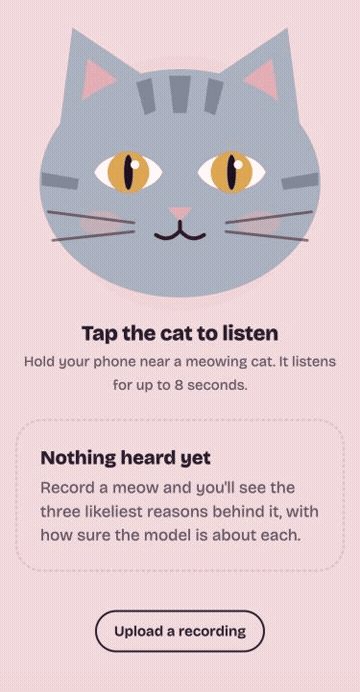

# Meow Decoder

[](https://github.com/ATHARV-IIT-BOMBAY/meow-decoder/actions/workflows/ci.yml)
[](https://huggingface.co/spaces/AtharvIITB/meow-decoder)
[](https://huggingface.co/AtharvIITB/meow-decoder)
[](LICENSE)



**Record a meow. Get the three likeliest reasons behind it, with percentages you can trust. Teach it your own cat and it learns that cat's voice.**

Cats don't meow in sentences, so this doesn't translate. It tells you which situation a meow sounds like (waiting for food, enjoying attention, or stressed somewhere new) and how sure it is. When it says 90%, it's right about 9 times in 10.

Every number here is measured on cats the model has never heard, because that's the situation you're in with a new cat. Most cat translators skip this test, which is how they get to 90%.

**[Try it in your browser](https://huggingface.co/spaces/AtharvIITB/meow-decoder)** · [How good is it?](#how-good-is-it) · [Help build the open cat dataset](#help-build-the-open-cat-dataset)

<br clear="right">

## Install

Needs Python 3.11+ and [ffmpeg](https://ffmpeg.org/download.html).

```bash
pip install "meow-decoder @ git+https://github.com/ATHARV-IIT-BOMBAY/meow-decoder"
```

Weights download automatically from Hugging Face the first time you run it.

## Use it

```bash
meow serve                     # the app, at http://localhost:8000
meow predict my-cat.m4a        # any audio or video file ffmpeg can read
```

```
my-cat.m4a
   62%  🍗 Food, please: "I'm hungry. Where's my food?"
   37%  🙀 Stressed somewhere new: "I don't know this place. Where are you?"
    0%  😽 Enjoying the attention: "That feels nice, keep going."
```

```python
from meow_decoder import Decoder

decoder = Decoder()                      # or Decoder("ast") for commercial use
result = decoder.predict("my-cat.m4a")   # path, bytes, or a 16 kHz numpy array
result["results"][0]   # {'key': 'F', 'title': 'Food, please', 'p': 0.62, ...}
result["sounds"]       # AudioSet scores for Cat, Meow, Purr, Caterwaul, Hiss
```

`meow predict --json` prints one JSON line per file. Phones only allow the microphone over https; to use the app from a phone, run `cloudflared tunnel --url http://localhost:8000` and open the link it prints.

## Teach it your cat

In the app, add your cat, record a meow, and tap what was really happening. The decoder refits on your cat's meows (each counts 20× a training meow). On cats it had never heard:

| Meows taught per situation | 0 | 1 | 2 | 3 | 4 |
|---|---|---|---|---|---|
| First guess right | 66% | 74% | 77% | 80% | 81% |

You can also teach it your own reasons, like "wants to go out", and they become new options for that cat. Your cats stay on your machine in `~/.meow-decoder` as names, photos and meow embeddings, never audio. Each browser only sees its own cats.

## How good is it?

The benchmark: 440 meows from 21 cats ([CatMeows](https://zenodo.org/records/4008297)), split into 5 fixed folds of whole cats ([`meow_decoder/splits.json`](meow_decoder/splits.json)). Every test meow comes from a cat the model never trained on. Run it yourself with `meow benchmark`.

| Model | First guess | Top two | Log-loss | Calibration error |
|---|---|---|---|---|
| **Meow Decoder, bioacoustic BEATs** (default) | **65.9%** | **89.1%** | **0.757** | **2.2%** |
| Meow Decoder, AST (commercial-safe) | 61.8% | 84.1% | 0.907 | 4.7% |
| [MeowSense](https://github.com/sbor3937/MeowSense), SVM on AST* | 60% ± 10 | | | |
| Classic MFCC features + logistic regression | 57.5% | | | |
| Always guess "stressed" | 50.2% | | | |

\*MeowSense uses its own grouped folds, so the comparison is close but not exact. [Submit your model](.github/ISSUE_TEMPLATE/benchmark-result.md) to add it here.

Per situation, it catches 84% of stressed meows, 60% of attention meows and only 30% of food meows. Food and attention meows sound alike to it. Accuracy on a single unseen cat ranges from 20% to 95%, which is why teaching your cat matters.

### Why published 90% figures don't compare

Many cat-sound papers augment their clips (noise, pitch shift, filtering) and then split them randomly, so altered copies of the same recording land in both training and test. On the 50 public clips of the Cat Sound Classification V2 dataset (10 emotions), the same model scores:

| Split | Accuracy |
|---|---|
| Augment, then split randomly | 99.8% |
| Keep every copy of a clip on one side | 84.4% |
| Chance | 10% |

[`benchmark/evaluate.py`](benchmark/evaluate.py) reproduces this and the full report (confusion matrix, calibration curve, per-cat accuracy, personalization curve) into [`benchmark/report.json`](benchmark/report.json).

## Help build the open cat dataset

Every open cat model, this one included, learned from the same 440 meows of 21 European pet cats. The fix is more data from more cats, and you can help:

1. In the app, tick **Also add this meow to the open cat dataset** before you tap what was happening.
2. Run `meow export-dataset my-meows` to bundle what you've shared, with a dataset card.
3. Upload it to Hugging Face or open an issue with a link, and we'll merge it into the shared dataset.

Only the sound, the label and an anonymous cat ID are kept, never your cat's name or photo. Shared meows are CC BY 4.0.

## Commercial use

The default encoder is [Earth Species Project's BEATs](https://huggingface.co/EarthSpeciesProject/esp-aves2-sl-beats-all), licensed **CC BY-NC-SA 4.0 (non-commercial)**. For anything commercial, use the AST encoder (BSD-3-Clause), about 4 points less accurate:

```bash
meow serve --encoder ast
```

## How it works

- Each clip goes through two frozen models. The bioacoustic BEATs encoder (or AST) turns it into a 768-number embedding, and a small logistic regression ranks the situations. MIT's AudioSet AST checks whether it sounds like a cat at all and listens for purring, hissing and yowling.
- The classifier weights are plain NumPy arrays on [Hugging Face](https://huggingface.co/AtharvIITB/meow-decoder), no pickles. `meow train` rebuilds them from CatMeows.
- The app is a FastAPI server ([`server.py`](meow_decoder/server.py)) and one HTML file ([`static/index.html`](meow_decoder/static/index.html)). The cat is the record button; its pupils follow the sound level and its face changes with the answer.

## Retrain or develop

```bash
git clone https://github.com/ATHARV-IIT-BOMBAY/meow-decoder && cd meow-decoder
pip install -e ".[dev]" && pytest
mkdir -p data && curl -L -o data/catmeows.zip "https://zenodo.org/records/4008297/files/dataset.zip?download=1" && unzip -q data/catmeows.zip -d data
meow train && meow benchmark      # writes weights/beats.npz, which then takes priority over the downloaded weights
```

See [CONTRIBUTING.md](CONTRIBUTING.md) for what helps most.

## Limits

- Three situations only. It can't detect pain or illness. If a cat seems unwell, see a vet.
- Trained on 21 Maine Coon and European Shorthair pet cats recorded by the University of Milan. Street cats and other breeds may sound different.
- The training audio is 8 kHz, so the models never heard anything above 4 kHz.

## Data, models and licenses

- Code: MIT.
- [CatMeows](https://zenodo.org/records/4008297), Ludovico et al. 2020, CC BY 4.0. Three of its meows ship as demo samples.
- [Cat Sound Classification Dataset V2](https://zenodo.org/records/4724180), Pandeya et al., CC BY 4.0, used only for the re-test.
- [esp-aves2-sl-beats-all](https://huggingface.co/EarthSpeciesProject/esp-aves2-sl-beats-all), Earth Species Project, CC BY-NC-SA 4.0.
- [AST fine-tuned on AudioSet](https://huggingface.co/MIT/ast-finetuned-audioset-10-10-0.4593), BSD-3-Clause.

If this helps your research, please cite it ([CITATION.cff](CITATION.cff)) along with CatMeows.
